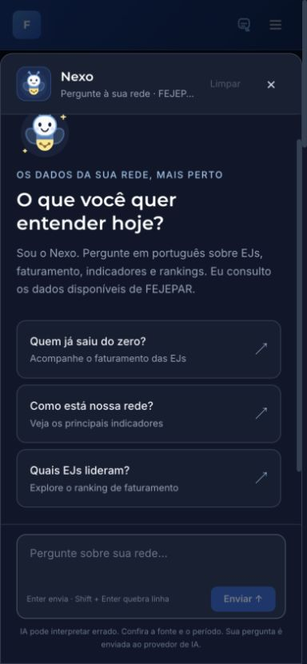

# Verificação local da evolução Nexo

Data: 04/10/2026 (America/Recife). Evolução realizada por três agentes em escopos separados: identidade/pesquisa, backend e frontend. Integração, mascote, avaliação real e verificação visual pelo agente principal. Sem alterações na monografia, commits ou publicação remota.

## Validação determinística

Comando: `../.venv/bin/python -m pytest -q -rs --require-lab`, a partir de `portal_fejepe`.

**453 passaram, nenhum pulado, quatro avisos existentes de depreciação no cliente Supabase.** A opção `--require-lab` falha se houver teste pulado. A bateria inclui 70 testes específicos da IA, com PostgreSQL real e usuário submetido a RLS. As cinco ferramentas são exercitadas com interpretação hostil e remoção dos filtros Python; busca e cluster também são verificados contra dados sintéticos de outra federação. Isso verifica a fronteira do banco independentemente da recusa do modelo.

Frontend: `npm run build` e `npm run lint` aprovados após a integração do mascote e a humanização das fontes. `git diff --check` aprovado.

## Modelo real: resultado e pendência

Configuração mantida: OpenRouter, `nvidia/nemotron-3-super-120b-a12b:free`, geração limitada a 2048 tokens e raciocínio explícito desativado. Nenhuma chave foi registrada nos relatórios.

A primeira execução do corpus ampliado de 19 perguntas teve zero erros de transporte, **17/19 ferramentas corretas**, **15/19 planos exatamente iguais ao gabarito**, **17/19 respostas iguais ao gabarito** e IDs de EJ autorizados em todas as respostas. Seis das oito recusas esperadas ocorreram. Uma pergunta ambígua e um pedido sobre outra federação foram interpretados como consultas locais; não houve acesso à outra federação, mas a resposta seria semanticamente inadequada. [Resultado inicial](ia-avaliacao-nexo-2026-10-04-inicial.json).

O prompt foi reforçado com prioridades e exemplos de recusa, eliminando a orientação contraditória de assumir faturamento num ranking ambíguo. A tentativa de reavaliação teve **19/19 erros de fornecedor**, sem resposta utilizável. Diagnóstico separado confirmou HTTP 429 e limite diário do fornecedor (`free-models-per-day`). [Execução bloqueada](ia-avaliacao-nexo-2026-10-04.json).

**A versão final do prompt ainda precisa ser reavaliada com o modelo real quando a cota renovar ou o administrador configurar outro modelo.** Não se afirma 100% de interpretação nem que os ajustes de prompt resolveram as falhas. O corpus foi usado para desenvolvimento, não é holdout. Nenhum modelo pago foi selecionado automaticamente.

## Verificação visual

No portal local, autenticado na FEJEPAR, foram verificados: abertura do Nexo, mascote e marca do tenant, consulta real e tratamento do limite, tentar novamente, limpar, fechar/reabrir, Escape com foco retornando ao botão e rascunho preservado. A verificação em viewport móvel de 390×844 não apresentou overflow horizontal do documento; o campo permaneceu acessível enquanto o corpo do painel rola. O viewport foi restaurado.

A apresentação de respostas numéricas na versão final não pôde ser verificada pelo navegador após o esgotamento da cota; tipos, units, serviços e composição foram validados pelos testes e build. Não foi feita auditoria com leitor de tela nem teste de carga.
